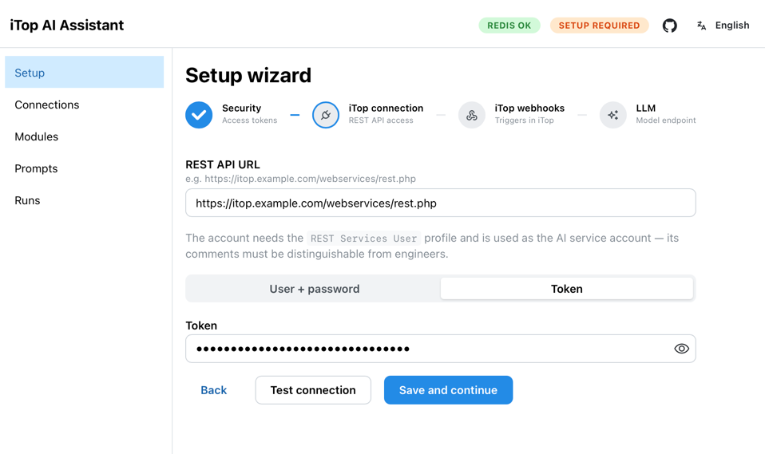

# iTop AI Assistant

[](https://github.com/knowitop/itop-ai-assistant/actions/workflows/release.yml)
[](https://codecov.io/gh/knowitop/itop-ai-assistant)
[](https://pypi.org/project/itop-ai-assistant/)
[](https://hub.docker.com/r/knowitop/itop-ai-assistant)
[](https://itop-ai-assistant.readthedocs.io/)

AI-powered middleware for [Combodo iTop](https://www.itophub.io/) that reduces ticket back-and-forth and helps engineers start working faster.

> **Title:** printer broken  
> **Description:** Not printing.
>
> **AI Assistant:** Thank you for reaching out! To help us resolve this quickly, could you please provide:  
> — the manufacturer and model of the printer;  
> — your operating system and version;  
> — the exact error message or what happens when you try to print.

**Looking for pilot teams** — run it on your live queue in dry run, with help on setup. [Details](https://github.com/knowitop/itop-ai-assistant/discussions/30).

---

## The problem

Engineers waste time on tickets that arrive without enough information: vague descriptions, missing hardware details, no steps to reproduce. Before any work can start, they have to write back to the user and wait. This creates delays, drops SLA metrics and frustrates everyone.

---

## How it works

> **The engineer sees the ticket only when it's ready to work on.**

When a new ticket arrives, iTop sends a webhook — there is no extension to install into iTop. A **single AI agent** decides what the ticket needs and acts through a fixed set of tools:

- **Classify** — picks the service and subcategory from the requester's catalog; an id that is not in the catalog is rejected.
- **Ask** — posts exactly **one** clarifying question in the public log and waits for the reply. Three questions per ticket at most by default.
- **Hand off** — writes a short internal note for the engineer and steps aside.
- **Quote what already worked** — with a vector index configured, the note links similar solved tickets.

The subcategory's own **description** in iTop is what the agent treats as the completeness criteria — so it asks for what that service actually needs, not "please describe the problem in more detail".

The limits — one question per run, the question ceiling, stopping once an engineer takes the ticket — are plain code, not instructions in a prompt: a model that misbehaves gets its call rejected rather than the ticket damaged. All actions run under a dedicated iTop service account, so every comment is attributed and auditable.

Both scenarios end to end, and the flow as a diagram: [How it works](docs/index.md#how-it-works).

---

## What you get around it

- **A setup wizard**, not a configuration file — security, iTop connection, webhook provisioning and the model, in four steps. Everything it sets can be re-edited later from the admin UI, and applies from the next ticket without a restart. ([Setup](docs/setup.md))
- **Dry run** — the assistant processes your live queue exactly as it would in production, records every decision, and writes nothing to iTop. Watch it work on your own tickets, then decide. ([Dry run](docs/configuration.md#dry-run))
- **A run journal** — every run, step by step: each model turn, each tool call and its result, tokens and wall time, with the full text of the question or note it would have posted. ([Runs](docs/admin-ui.md#runs))
- **Optional self-hosted LLM tracing** — the prompt and the raw model answer, exported over OTLP to a receiver you run yourself. Off by default; the bundled stack ships one behind a compose profile. ([LLM tracing](docs/configuration.md#llm-tracing))
- **Your model, your infrastructure** — OpenAI, Google Gemini, Ollama, or any OpenAI-compatible endpoint, including a model running on your own hardware. Nothing about the design assumes a cloud provider.
- **Prompts you can edit** — every prompt the agent uses is editable in the UI or shadowed from a directory on disk, with the packaged default one click away. ([Customizing prompts](docs/prompts.md))
- **An admin UI in 12 languages**, module settings included — a module ships its own labels, so the settings screen speaks the same language as the rest.

---

## Requirements

- **iTop 3.x** with REST API enabled — no extension to install, only a service account, triggers and webhooks, which the wizard can create for you
- **An LLM that calls tools reliably** — see [supported providers](docs/configuration.md#supported-llm-providers)
- **Redis**; optionally **Qdrant** and an embeddings endpoint for the similar-tickets references ([vector index](docs/configuration.md#vector-index)) — both are in the compose stack
- **Docker and Docker Compose**

---

## Quick start

```bash
git clone https://github.com/knowitop/itop-ai-assistant.git
cd itop-ai-assistant/docker
cp .env.dist .env
docker compose up -d
```

The stack starts iTop, Redis, Qdrant and the assistant together. The bundled iTop starts empty — run its installation wizard first; [Setup](docs/setup.md#the-bundled-itop) says which choices matter to the assistant. Bringing your own iTop, or your own compose file: [Getting it running](docs/setup.md#getting-it-running).

The image is `knowitop/itop-ai-assistant` on Docker Hub and `ghcr.io/knowitop/itop-ai-assistant` on GHCR, for `linux/amd64` and `linux/arm64`. Tags: the full version, `major.minor`, `major` and `latest`; `edge` follows `main`.

| Service   | URL                          |
|-----------|------------------------------|
| iTop      | `http://localhost:8000`      |
| Admin UI  | `http://localhost:8001/ui`   |
| API docs  | `http://localhost:8001/docs` |

Open `http://localhost:8001/ui` — the **Setup Wizard** starts automatically and walks you through all the required steps.



---

## Documentation

Also hosted, with search, at **[itop-ai-assistant.readthedocs.io](https://itop-ai-assistant.readthedocs.io/)**.

- [**Setup**](docs/setup.md) — getting the stack running, the setup wizard, manual iTop configuration, and how to try the assistant on your own data first
- [**Admin UI**](docs/admin-ui.md) — Connections, Modules, Prompts, Runs and Vector index screens
- [**Configuration**](docs/configuration.md) — environment variables, module settings, dry run, LLM tracing, supported LLM providers and the vector index
- [**Customizing prompts**](docs/prompts.md) — editing LLM prompts via UI or files
- [**Telemetry**](docs/telemetry.md) — the anonymous daily document: every field, who receives it, and how to switch it off

---

## Getting help

- **Questions and ideas** — [GitHub Discussions](https://github.com/knowitop/itop-ai-assistant/discussions): setup, choosing a model, why the assistant asked what it asked.
- **Bugs** — [GitHub Issues](https://github.com/knowitop/itop-ai-assistant/issues). Include the assistant's version and what the run journal shows for the ticket.
- **На русском** — [the project thread on community.itop-itsm.ru](https://community.itop-itsm.ru/t/itop-ai-assistant-ii-pomoshhnik-dlya-priyoma-zayavok-v-itop/2155).

**Want to try it on your live queue?** I'm looking for a few teams on iTop willing to run the assistant on their real tickets and tell me honestly what works and what doesn't. Start in dry run — nothing is written to iTop until you decide. I'll help with the installation and with the subcategory descriptions the assistant relies on. Reply in [the pilot thread](https://github.com/knowitop/itop-ai-assistant/discussions/30).

---

## Roadmap

Today the assistant covers intake. Next is an **engineer console** inside the iTop ticket page — summaries, similar past tickets and draft replies on request. Further out: pattern analysis across tickets, knowledge base maintenance and Change Management review. Right now, though, the priority is getting intake right on live queues rather than adding modules.

---

## Contributing

Local development, tests and conventions: [CONTRIBUTING.md](CONTRIBUTING.md).

---

## License

[AGPL-3.0](LICENSE)
